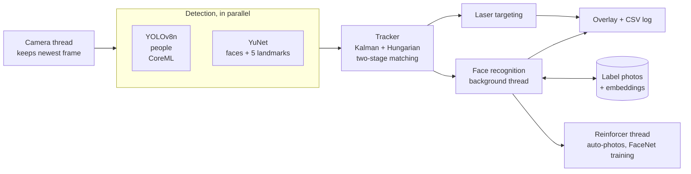

# Real-Time Face Tracker

A real-time computer-vision system in C++ that tracks **people and faces** through a MacBook camera (or a
video file), **recognizes specific people** from a few photos, gets better at recognizing them on its own,
and marks a face with a red **`TARGET`** box when a red laser dot is on it.

It runs two neural networks in parallel on every frame, keeps a stable ID on everything it tracks, and
runs at the camera's full 30 frames per second on an Apple Silicon Mac.

| | Result (measured on recorded reference clips) |
|---|---|
| Speed | **30 FPS** live (the camera's maximum), up from ~10 FPS in the first version; ~15 ms from capture to screen |
| Tracking stability | identity switches on the benchmark clip: **75 → 4** |
| Lag behind fast motion | **13 ms → 6–7 ms** |
| Face recognition | the enrolled person is labeled in **99%** of face frames |
| Laser TARGET | on within **0.13 s** of a dot landing on the face; **0** false triggers on the wall, hair, shirt, a red sticker, or real footage without a laser |
| Tests | **186** unit tests (GoogleTest) plus headless regression runs on recorded video |

---

## Contents
- [What it does](#what-it-does)
- [How it works](#how-it-works)
- [Setup, build and run](#setup-build-and-run)
- [Recognizing people (face labels)](#recognizing-people-face-labels)
- [The laser TARGET](#the-laser-target)
- [Logs, measurements and tools](#logs-measurements-and-tools)
- [Testing](#testing)
- [Branches](#branches)
- [Project layout](#project-layout)

---

## What it does
- **Detects** people (YOLOv8n) and faces (YuNet) in every frame.
- **Tracks** each one across frames with a stable, per-type number (`person #1`, `face #2`). Numbers are
  never reused within a run, and a track survives short detection drop-outs.
- **Recognizes** people you've taught it from 5–10 photos, showing their name instead of `face #n`.
- **Learns as it goes:** while it recognizes someone, it occasionally saves a new, useful photo of them,
  behind strict quality checks, and trains a small neural network in the background.
- **Targets** a face that a red laser dot is on (a red box labeled `TARGET`). The dot must be on the face
  itself, not merely inside the face's detection box.
- **Draws** a clean overlay (tags that avoid each other, a status panel, help on `h`), and **logs** every
  visible track to CSV for analysis.

## How it works



### 1. Capture
A dedicated thread reads the camera and keeps only the **newest** frame, so processing never works through
a queue of stale frames. Each frame is timestamped; the end-of-run report shows how old frames were when
processing started. Video files use the same interface; `--realtime` makes a file drop frames like a live
camera does.

### 2. Detection: two networks in parallel
- **YOLOv8n** finds people. The model has COCO's 80 classes, but the decoder reads only the box and *person*
  score rows of its output tensor, so no other class ever reaches non-maximum suppression (NMS, which merges
  overlapping boxes of the same object).
- **YuNet** finds faces and 5 landmarks per face: both eyes, the nose tip and both mouth corners.
- The two run on separate threads, so a frame costs the slower of the two, not their sum.
- **Speed-up from ~10 to 30 FPS:**
  - YOLO runs on Apple's GPU / Neural Engine through **ONNX Runtime with the CoreML execution provider**.
  - It was re-exported at **640×384**, which suits a 16:9 camera frame better than 640×640 and wastes less
    compute on padding.
  - A model is given to CoreML **only if CoreML can run its whole graph**. A partly supported model bounces
    data between the CPU and the accelerator, and in testing ran slower than plain CPU.
  - Compiled CoreML models are cached in `.cache/coreml/`.
- Each detector has two confidence levels: **strong** detections can start tracks, while **weak** ones can
  only keep existing tracks alive.

### 3. Tracking
A SORT/ByteTrack-style multi-object tracker (`src/Tracker.cpp`, `src/KalmanBox.cpp`, `src/Assignment.cpp`):
- **One Kalman filter per track.** It models a constant-velocity box (center, size and their velocities).
  Each frame it *predicts* where the object should be and *corrects* with the matched detection. It's
  advanced by the **real time between frames**, so a dropped frame doesn't distort motion.
- **Snapping.** When the filter and the detection disagree by more than the detector's normal jitter (fast
  motion), the box moves toward the detection, so it doesn't trail behind a quickly turned head.
- **Optimal matching.** Tracks and detections are paired with the **Hungarian algorithm** (a globally best
  one-to-one assignment). The cost combines box overlap (IoU, intersection over union) and center distance
  measured in units of object size, with gates on size ratio and distance.
- **Two stages (ByteTrack's idea).** Confident detections are matched first, then weak detections to the
  tracks still unmatched.
- **Track lifecycle:**
  - A track needs 3 matches before it's shown, which filters one-frame false positives.
  - A missing track *coasts* on its prediction (drawn with corners only) while its velocity decays.
  - It's dropped after a timeout, which is longer at the frame edge, where an object probably just left.
- **Numbering.** Each class keeps its own counter, and a number is given only when a track is confirmed.

### 4. Face recognition
`src/Labels.cpp`, `src/Enrollment.cpp`, `src/Recognizer.cpp`, `src/Embedder.cpp`.
- **Enrollment.** Each person is a folder of photos. A sync finds the face in each photo, aligns it with its
  landmarks, and turns it into an **embedding** with **SFace**: 128 numbers, normalized, where photos of
  the same person point in nearly the same direction. A mirrored copy is embedded too, because the live view
  is mirrored. Embeddings are cached per photo, keyed by name, size and modification time.
- **Live matching.** Face crops go to a **background thread** for embedding, so the frame rate is unaffected,
  and are compared with each label's photos by **cosine similarity**.
  - A label's score is the mean of its 3 most similar photos.
  - It must pass a threshold and beat the runner-up label by a margin.
  - A face takes a name after 3 agreeing checks and loses it after 4 misses, so names don't flicker.
  - Each label (one person) belongs to at most one face at a time.

### 5. Self-reinforcing recognition
`src/Reinforcement.cpp`, `src/FaceNet.cpp`.
- **Auto-photos.** While a person is recognized, it occasionally saves a new photo of their face into their
  label folder, which is used at once and on every later start. The hard part is **not reinforcing
  mistakes**, so a photo is taken only when all of these hold:
  - the match is stable (5 matching checks in a row) and clear (score and margin above the normal bar);
  - the face is detected now, at least 80 px wide, sharp (variance of the Laplacian), and not under the laser;
  - it's **new** (not too similar to the label's existing photos);
  - it's rate-limited (one per 30 s per person, at most 40, replacing the most redundant one; your own
    photos are never touched).
- **FaceNet**, a small neural network:
  - an ensemble of three multilayer perceptrons (`cv::ml::ANN_MLP`, 128 → 32 → one output per person +
    "other") trained on the embeddings in a background thread;
  - the "other" output learns from strangers' **embeddings** (never their photos);
  - a single network was badly overconfident on strangers; averaging three, trained with noise
    augmentation, cut false confident matches from 6–12% to under 1% in tests;
  - it stays **off** until it has seen enough people (3 photos of each label and 20 faces of 5+ others),
    because a network that has never seen strangers labels everyone as someone it knows;
  - once on, it can relax a borderline match or veto a doubtful one; the photo matching stays the rule.
- **Threads.** Only the tracking thread changes label data. Workers get copies. Trained networks are
  published as immutable `shared_ptr<const FaceNet>` objects. A ThreadSanitizer build of the threaded tests
  reported nothing.

### 6. Laser TARGET
`src/Targeting.cpp`:
- **Face geometry.** An oval from the 5 landmarks (forehead to chin, cheek to cheek, tilted with the eyes),
  cut to the face's detection box. Hair, ears, the neck and the wall in the box's corners fall outside it.
  Implausible landmarks (for example a hand over the face) fall back to a safe oval.
- **A laser adds light.** So a dot is judged against the skin **right around it**: red rises well above the
  skin and much more than green and blue, often with an overexposed white middle. This works across skin
  tones and lighting. On bright skin, where red has little room left below 255, the rule scales down and
  requires the white middle.
- **Light vs. pigment.** A dot must *glow* (brighter red than its surroundings) and not be darker in green or
  blue, which rejects red stickers, bindis and red marks that merely reflect light.
- **Shape and context.** It must be small and round, with a ring of that face's skin around it.
- **Timing.** On after 0.1 s of dot, released after 0.3 s without it, kept up to 0.75 s while the face is
  briefly undetected. Only faces can be targets, one at a time.

### 7. Overlay and output
Tags are dark plates with a colored stripe, placed so they never overlap each other or leave the frame. A
status panel shows FPS, counts per class and active modes. **Red is reserved for `TARGET`**, and a unit test
checks that nothing else is drawn red. Drawing costs ~0.2 ms per frame.

---

## Setup, build and run
**Requirements:** macOS on Apple Silicon, Homebrew.

```sh
brew install cmake opencv onnxruntime googletest clang-format
scripts/fetch_models.sh          # downloads and checksums the face and recognition models
scripts/export_yolo.sh 384 640   # YOLO with a 16:9-friendly input (installs Ultralytics in .venv)

cmake -S . -B build
cmake --build build -j8
ctest --test-dir build           # unit tests
```

```sh
./build/tracker                          # camera 0: people and faces
./build/tracker --debug                  # show confidences, laser results, label scores and timings
./build/tracker --classes face           # only these classes (person, face, label names)
./build/tracker --video clips/demo.mov   # a video file instead of the camera
./build/tracker --video clips/demo.mov --no-window   # headless: just the log and a summary
./build/tracker --video clips/demo.mov --realtime    # play at camera speed, dropping frames when busy
./build/tracker --record clips/new.mov   # also save the raw camera feed
./build/tracker --backend cpu            # don't use CoreML
./build/tracker --help                   # all options
```
**Keys:** `p` pause, `t` motion trails, `d` debug view, `h` help, `q`/`Esc` quit. The first camera run asks
for camera access: allow it for your terminal app in **System Settings → Privacy & Security → Camera**.

## Recognizing people (face labels)
1. Make a folder named after the person, e.g. `labels/alex/` (letters, digits, `_` and `-`; not `TARGET`).
2. Put **5–10 photos** of their face in it, from different angles and in different light. JPEG and PNG
   work; convert iPhone HEIC first (`sips -s format jpeg IMG_1234.heic --out IMG_1234.jpg`).
3. Run the tracker. At startup it processes new and changed photos and reports on each one.

```sh
./build/tracker --sync-labels              # process photos now and check every label
./build/tracker --list-labels              # photos and usable photos per label
./build/tracker --enroll alex a.jpg b.jpg  # or copy photos into labels/alex/
./build/tracker --add-photos alex c.jpg
./build/tracker --rename-label alex alexis
./build/tracker --remove-label alexis      # moves the folder to labels/.removed/, photos kept
./build/tracker --no-auto-photos           # recognize, but take no photos
./build/grab_frames clips/new.mov /tmp/alex --crop face --count 8   # face photos from a video
```
- A sync flags photos without a face, photos that don't look like the rest, labels with fewer than 5 usable
  photos, and labels so alike that recognition may confuse them.
- An optional `label.yml` can set `threshold:` and `auto_photos: false`.
- **Privacy:** everything stays on your computer in `labels/`, which is git-ignored. Photos are taken only of
  people you labeled. Other faces are kept only as anonymous embeddings (at most 500) in
  `labels/.negatives.yml`; delete it to forget them.

## The laser TARGET
> **Laser pointers can damage eyes in a fraction of a second.** Aim at the cheek or forehead, never near
> the eyes, or test with a printed photo of a face.

- `--laser-redness N` (default 35) sets how much more a dot's red must rise than its green and blue.
- `--no-targeting` turns it off.
- `--dump-laser file.csv` writes, for each face and frame, whether a dot was found, where, its size,
  redness, glow and how much of its surroundings is skin: useful for tuning on a recorded clip.

**Testing without a laser.** `scripts/make_laser_clip.py` draws physically modeled laser dots onto real
footage (added as light, with the camera's color subsampling, saved losslessly). The dots go at positions
computed from the tracker's own face landmarks: on the cheek, forehead and nose (should be TARGET), and on
the wall inside the face box, above the hairline, beside the head, the shirt, and a static red mark (should
not):
```sh
./build/tracker --video clips/demo.mov --no-window --no-log --dump-detections /tmp/dets.csv
.venv/bin/python scripts/make_laser_clip.py clips/demo.mov /tmp/dets.csv /tmp/laser.mkv /tmp/schedule.csv
./build/tracker --video /tmp/laser.mkv --no-window --dump-laser /tmp/laser_dump.csv
```

## Logs, measurements and tools
- **CSV log.** Every run writes `logs/run_<date>_<time>.csv`, one row per visible track per frame: `time_ms`,
  `frame`, `id`, `number`, `class`, `label`, `matched`, the box, `conf`, `target`, `laser`, `coasting`.
- **`scripts/log_stats.py logs/run_*.csv`** summarizes runs: IDs per class, track lifetimes, and flicker per
  minute (boxes that vanish and return, wobble, or change label or number).
- **Latency report.** Every run ends with the time per frame of each stage, mean and 95th percentile:
  capture age, detection, tracking, labels and targeting, drawing, display, and capture to screen.
- **Tracker replay.** Tune the tracker without re-running the neural networks: save a clip's detections once,
  then replay them with different parameters.
  ```sh
  ./build/tracker --video clips/demo.mov --no-window --no-log --dump-detections /tmp/dets.csv
  ./build/tracker_replay /tmp/dets.csv --tracks lostTimeout=1.5   # any TrackerParams field
  ```

## Testing
- **186 GoogleTest unit tests** (`tests/`):
  - the tracker (stable IDs, coasting, edge exits, weak detections, snapping);
  - Hungarian assignment and the Kalman filter;
  - YOLO decoding and the ONNX/CoreML model loader;
  - the label database (sync, enrollment, migration, corrupt photos);
  - face reinforcement (every capture gate, the network's training and its off state);
  - laser targeting (synthetic scenes: bright and dark skin, static red marks, broken landmarks, timing);
  - the overlay (layout, and only `TARGET` drawn red).
- **Regression runs.** Headless runs on two recorded reference clips, compared with numbers kept in
  [PLAN.md](PLAN.md): IDs per class, TARGET episodes, recognition rate and FPS. Every change was measured
  before and after.
- **Mutation checks.** Some new checks were verified by reverting them and confirming their tests fail.

## Branches
| Branch | What it is |
|---|---|
| `laser-target` (default) | the version described here: laser `TARGET`, people and faces, face recognition with reinforcement |
| `flashlight-targeting-base` | the same system, plus hand detection, with a `TARGET` triggered by a bright light suddenly shining on a face |
| `main` | the original prototype (YOLO + face + hand detection with a simple SORT-style tracker) |

[PLAN.md](PLAN.md) records the full development history: each milestone, the design decisions, and the
measurements behind them.

## Project layout
```
src/
  main.cpp              the frame loop: capture → detect → track → target / recognize → draw and log
  Camera                capture thread that keeps only the newest frame
  Detector, IDetector   runs the detectors side by side
  YoloDetector          people (YOLOv8n, person scores only)
  FaceDetector          faces + 5 landmarks (YuNet)
  OrtModel              ONNX Runtime wrapper; CoreML only when it covers the whole model
  Tracker, KalmanBox,   multi-object tracking: Kalman filters, Hungarian assignment, two-stage matching
  Assignment
  Targeting             laser-dot TARGET
  Labels, Enrollment    face-label folders, photo syncing and caching
  Embedder              SFace face embeddings
  Recognizer            live recognition on a background thread
  Reinforcement,        auto-photos and the FaceNet ensemble
  FaceNet
  Overlay, TagLayout    drawing, tag placement, status panel, help
  Options, Logger,      command line, CSV log, latency statistics
  Latency
tools/      tracker_replay (tracker on saved detections), grab_frames (frames or face crops from a video)
tests/      GoogleTest unit tests
scripts/    fetch_models.sh, export_yolo.sh, log_stats.py, make_laser_clip.py
```
Not in git (see `.gitignore`): `build/`, downloaded `models/*.onnx`, `clips/`, `labels/` (your photos),
`logs/`, `.cache/`, `.venv/`.
